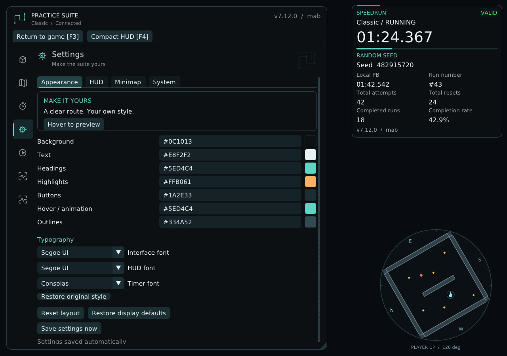
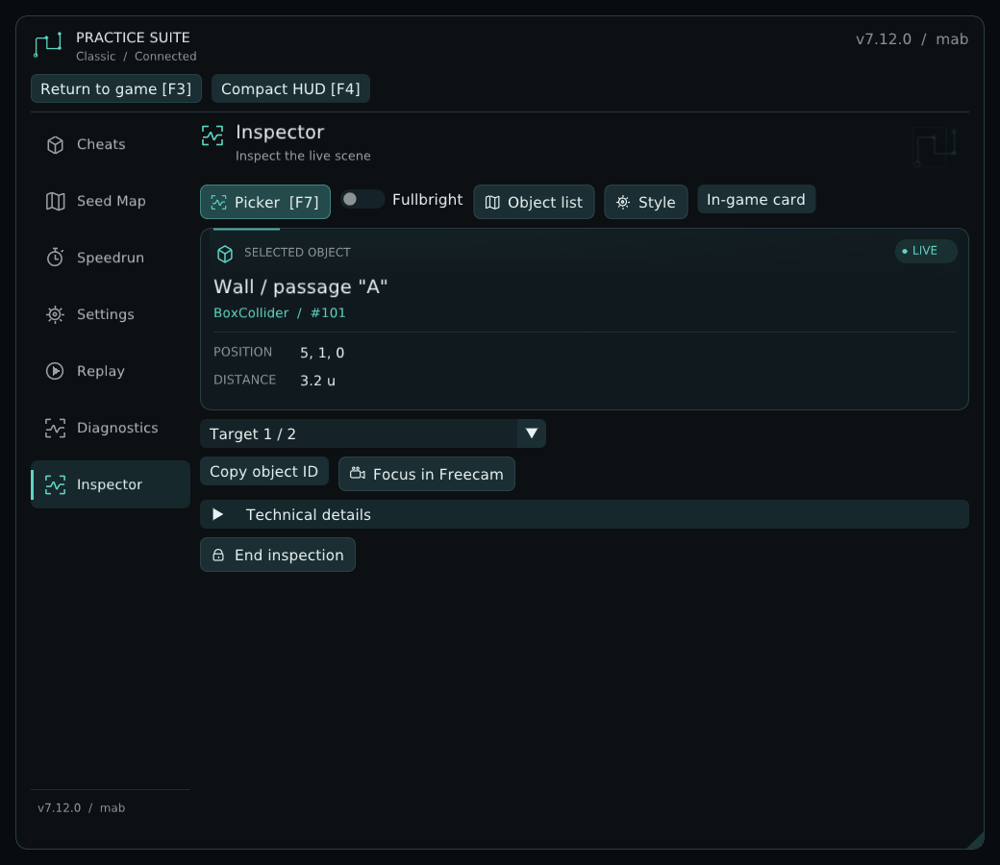
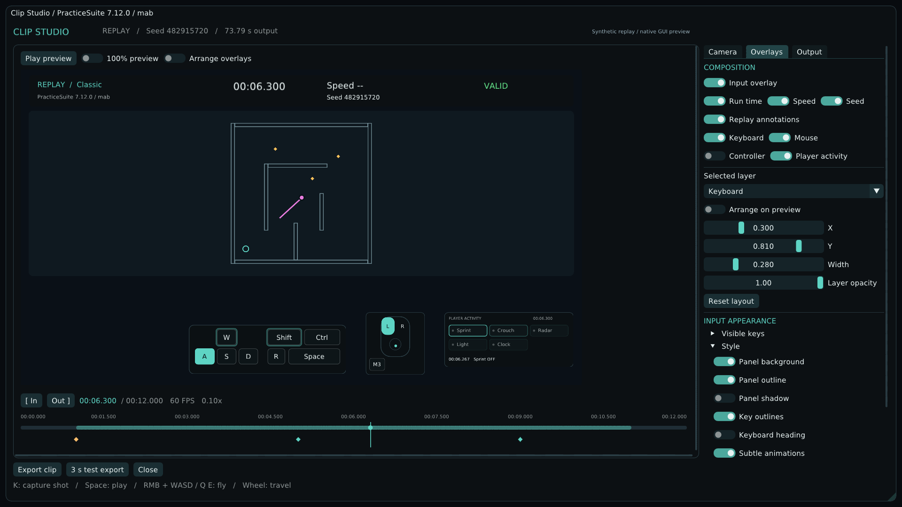

<picture>
  <source media="(max-width: 720px)" srcset="assets/hero-mobile.svg">
  
</picture>

  A community practice, routing, speedrun, and replay suite for <strong>It Steals</strong>. 
  Windows x64 · MelonLoader · Native trainer · Built by <strong>mab</strong>

  
  &nbsp;
  

  <a href="#get-started">Install</a> · <a href="#inside-the-suite">Preview</a> · <a href="#features">Features</a> · <a href="#downloads">Downloads</a> · <a href="CHANGELOG.md">Changelog</a> · <a href="DEVELOPING.md">Development</a>

## Get started

| Step | What to do |
| --- | --- |
| **1 · Download** | Get **ItStealsSuite-Setup.exe** from the [latest release](https://github.com/mabtm/It_Steals-Suite/releases/latest). |
| **2 · Choose the game** | Close It Steals and the trainer, run Setup, and confirm the detected game folder or browse to **It Steals.exe**. |
| **3 · Install** | Choose the Suite folder and optional desktop shortcut; Setup installs the trainer, encoder, mod, and MelonLoader when needed. |
| **4 · Play** | Start **PracticeSuite** from its shortcut; it starts the game automatically. Press **F3** to open the menu. |

Use **windowed or borderless** mode for the overlay. No compiler is needed. Setup requires Windows 10/11 x64, administrator access, and an installed Windows Mono copy of It Steals. A first-time MelonLoader installation needs an internet connection.

<strong>Prefer a portable installation?</strong>

1. Install [MelonLoader](https://github.com/LavaGang/MelonLoader.Installer/releases) for your **It Steals.exe** using its official installer; follow any prerequisites it requests and launch the game once.
2. Extract **ItStealsSuite-Portable.zip** to a writable folder.
3. Close the game and copy the included **ItStealsHelper.dll** into the game's **Mods** folder.
4. Keep **ItStealsTrainer.exe**, **PracticeSuiteEncoder.exe**, and the **Encoder** folder together; start the game and trainer, then press **F3**.

For automatic game startup, Steam installations are detected. For a custom location, create a UTF-8 **installation.ini** beside the trainer:

~~~
gameExecutable=C:\Games\It Steals\It Steals.exe
~~~

Turn automatic startup off under **Settings → System**, or pass **--no-launch** to skip it once. The trainer reuses an existing game and does not restart it after you close it.

<strong>What Setup changes, updates, and keeps</strong>

- Detects primary and secondary Steam libraries, or accepts your selected game folder.
- Checks that the game is a Windows x64 Mono installation.
- Downloads official **MelonLoader 0.7.3 x64** only when needed and verifies its pinned SHA-256 before extracting.
- Keeps a complete existing MelonLoader installation; conflicting or incomplete installations need repair with the official installer.
- Installs the PracticeSuite mod into **Mods**, and the trainer, encoder, encoder sources/licenses, and startup configuration into the separate Suite folder.
- Creates Start-menu and optional desktop shortcuts using the embedded Suite icon.
- Verifies package files and restores previous files if a copy fails.
- Provides a Windows uninstaller that removes unchanged files owned by the Suite and keeps modified files, other mods, MelonLoader, replays, and settings.

Settings and recordings remain in the user's local application data. Normal trainer use does not require administrator access. Setup finishes by offering the installation folder, so it does not start an elevated trainer or game.

## Stay up to date

Open **Updates** to see **Current / New**, check manually, install an update, or browse the complete version history. Automatic checks run in the background on startup and every 20 minutes. **Install / Later** appears once per game session, after the intro; restarting the trainer allows the prompt again. Runs and exports defer installation.

**Install** downloads and checks the complete package first. Accept the Windows permission prompt; the updater closes the verified game and trainer processes, replaces the files with rollback protection, and restarts both. Settings and replays stay in place. Each new installed version shows its full changelog once after the intro, including an offline history of previous versions.

<strong>Private builds and connection settings</strong>

Private releases need access to this repository. In **Updates → Connect private releases**, save a fine-grained GitHub token restricted to this repository with **Contents: read** permission. Windows Credential Manager stores it for your account on this PC; it is never bundled, written to settings, or included in reports. **Disconnect** removes it. Public releases work without a token.

Install **7.12.1** once using Setup or the full portable package to receive the updater. Older trainer executables cannot update themselves retroactively. Automatic restart also works when ordinary game auto-start is disabled.

## Inside the suite

*Actual production interface rendered with synthetic test data. Colors, placement, readability, and the native layout shown here are from the Suite.*

<strong>Live Inspector — inspect the scene without losing your place</strong>

A dedicated workspace and floating object card keep picking, highlights, layers, and requested details close together. This interface preview uses synthetic Inspector fixtures.

<strong>Clip Studio — from recorded inputs to a finished clip</strong>

Set the range, author camera keypoints, choose information and input layers, and check the composition before rendering. This preview uses a synthetic map replay; it is not a screenshot of original-game 3D rendering.

## Features:

**Practice and explore**

- **Fullbright:** Brighten practice and replay scenes using reversible unlit texture shaders.
- **Freecam:** Explore independently without collecting crystals, with an optional player teleport for practice.
- **Actual colliders:** Display captured collider shapes for players, monsters, crystals, and scene geometry.
- **Fixed seeds:** Reuse a seed, seed type, and spawn settings for repeatable layouts.
- **Scene controls:** Load supported practice modes and refresh captured map geometry.
- **Live Inspector:** Pick visible object layers, inspect properties and colliders, watch changes, compare baselines, and probe paths from a workspace or floating card.

<strong>Seeds, maps, and route planning</strong>

- **Seed search:** Rank layouts using spawn filters, complete routes, background workers, and verified portable generation where available.
- **Pickup routing:** Plan checked walkable paths using player clearance and captured crystal collection regions.
- **Route timing:** Estimate travel time with continuously learned straight, turning, starting, and slope movement when compatible data is available.
- **Seed preview:** Inspect layouts, preview spawns, reveal complete planned paths, and transfer selected seeds into practice.
- **Minimap:** View physical wall contours, crystals, player trails, monster paths, and optional route guidance.

Route quality describes the captured model: larger layouts and pickup-region ordering use heuristics, and time estimates cannot predict enemy interference or player mistakes.

<strong>Speedruns, HUDs, and inputs</strong>

- **Clean speedruns:** Track timer, splits, personal bests, seed, and observed validity with a mandatory status badge.
- **Run statistics:** Keep attempts, resets, completions, deaths, local bests, and daily/session progress.
- **Finish screen:** Review check details, personal-best comparison, seed, and replay access in a dismissible result view.
- **HUD editor:** Adjust HUD placement, scale, opacity, colors, fonts, metrics, and camera heading.
- **Input overlay:** Show selectable keyboard, mouse, controller, and observed player-state information in game or replay clips.

<strong>Replay library and analysis</strong>

- **Replay library:** Retain eligible completed or aborted runs with status, mode, seed, time, names, categories, and notes.
- **2D analysis:** Compare recorded and planned routes with pickups, monster movement, and flashlight/camera flashes.
- **3D playback:** Review recorded movement and camera data in recorded, follow, or free views using original or simplified scene graphics.
- **Timeline controls:** Seek, pause, loop, change playback speed, and add named markers.
- **Replay layers:** Toggle captured colliders, speed trails, ceiling visibility, fullbright, and supported scene overlays.
- **Recording check:** Inspect movement, camera, input, collider, animation, visual, and audio coverage before analysis or export.
- **Game events:** Review captured monster states, game queries, animation data, and recorded game audio.
- **Replay packages:** Import and export compatible packages while preserving replay identity and companion tracks.

Available detail depends on what was captured; older recordings cannot recover missing tracks.

<strong>Clip creation and export</strong>

- **Cinematic keypoints:** Author cuts and eased camera moves, switch camera modes, and animate playback speed and scene-layer settings.
- **Clip Studio:** Preview timeline ranges and customize information, inputs, composition, and export settings.
- **Video formats:** Export MP4, lossless MKV/AVI, editing MOV, GIF, or PNG sequences using purpose-specific presets and supported 30/60/120 FPS options.
- **Size budgets:** Re-encode a rendered clip toward a selected file-size budget using two-pass compression.

The separate encoder, its corresponding source, and licenses are bundled; original game assets are read from your own installation.

<strong>Diagnostics, appearance, and display</strong>

- **Diagnostics:** Scan known connection and performance conditions and copy reports or save local snapshots without uploading them.
- **Appearance:** Customize theme colors, fonts, animations, quiet interface sounds, and startup graphics.
- **Display controls:** Set overlay refresh, temporary game FPS/VSync overrides, and borderless window mode without rewriting saved game preferences.
- **Updates:** Check GitHub releases, install verified packages with automatic restart, and browse complete current and historical changelogs.
- **Startup:** Start the installed game once when opening the trainer, with a saved opt-out and a one-time command-line override.

### Game modes

| Supported | Supported |
| --- | --- |
| Classic | Classic Bonus |
| Camera | Camera Bright |
| Timer | Ghost |
| Hide & Seek **WIP** | Hide & Seek Outside **WIP** |

**Map geometry, minimap, and seed search in both Hide & Seek modes remain work in progress.** Other features depend on the recorded scene and available tracks.

## Downloads

[Latest release](https://github.com/mabtm/It_Steals-Suite/releases/latest) · [All releases](https://github.com/mabtm/It_Steals-Suite/releases)

| Asset | Use |
| --- | --- |
| **ItStealsSuite-Setup.exe** | Guided installation with game detection and branded shortcuts. |
| **ItStealsSuite-Portable.zip** | Complete package for manual installation, including encoder source/licenses. |
| **ItStealsTrainer.exe** | Individual native trainer executable. |
| **PracticeSuiteEncoder.exe** | Individual video encoder; keep it beside the trainer. |
| **ItStealsHelper.dll** | PracticeSuite mod; place it in the game's **Mods** folder. |
| **Encoder-Sources.zip** | Corresponding encoder source, build script, and licenses for redistribution. |
| **SHA256SUMS.txt** | SHA-256 checksums for the six downloadable packages/binaries above. |

Trainer **7.12.1** intentionally uses compatible mod **7.11.4** and main protocol **29**. The release workflow builds the native trainer, verifies installer/update behavior and the real private-release download, and publishes the seven assets together after checks pass.

## Shortcuts

| Key | Action |
| --- | --- |
| **F3** | Open or close the menu |
| **F1 / F2 / F4** | Freecam / optional overlay visibility / compact HUD when allowed |
| **F5 / F6** | Refresh map data / request borderless mode |
| **F7** | Start or cancel the Inspector picker |
| **F8** | Analyze a finished run while the prompt is available |
| **Shift+T / T** | Toggle speedrun mode / restart in game |

<strong>Connection help and important limits</strong>

**No connection?** Check that MelonLoader loaded **ItStealsHelper.dll**, keep trainer/mod versions compatible, and open **Diagnostics** for a scan and suggested fixes.

**No overlay?** Use windowed or borderless mode and press **F3**; **F6** requests borderless mode from the game.

**Game did not start?** Confirm the game folder in Setup or **installation.ini**, check **Settings → System**, or use the tray menu's **Start It Steals** action.

**Windows warning?** Current builds are unsigned; check the repository/release origin and supplied hashes.

**Run validation?** Checks describe observed local conditions and violations; they are not tamper-proof certification or a substitute for moderator review.

---

Unofficial community project by **mab**, not affiliated with the game's developer. Original game assets and Unity/MelonLoader assemblies are not distributed here.

[Development, architecture & tests](DEVELOPING.md) · [Changelog](CHANGELOG.md) · [Encoder source & licenses](Encoder/NOTICE.md) · [ImGui license](Trainer/imgui/LICENSE.txt)
