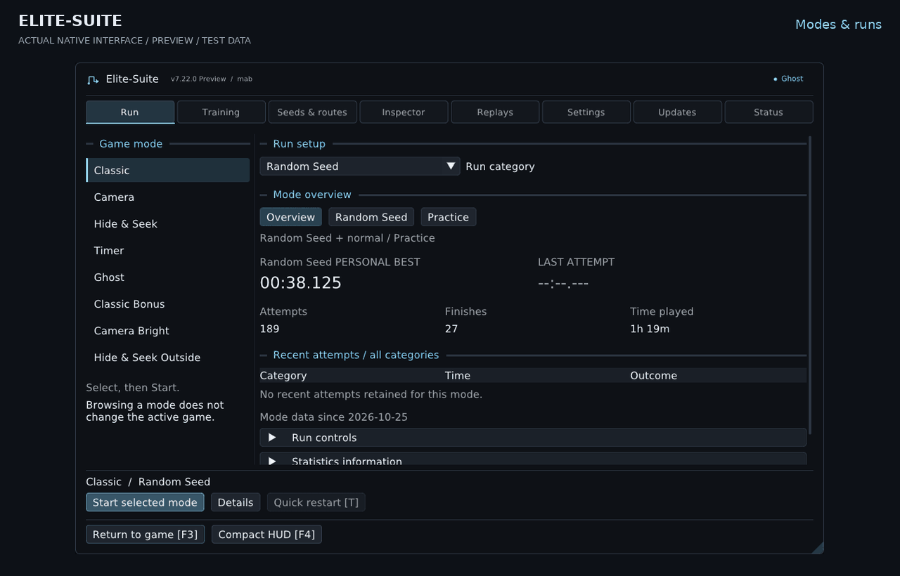
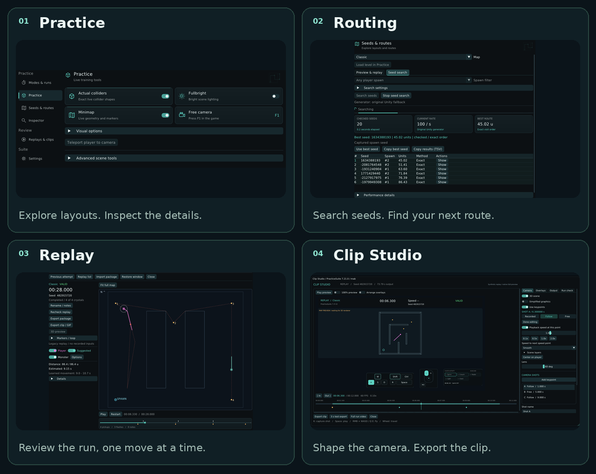
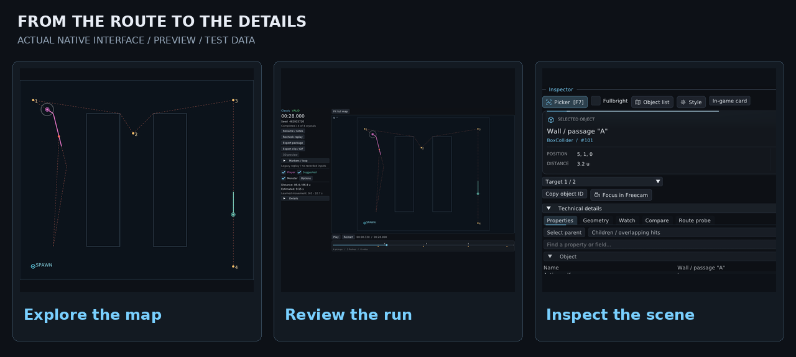

<picture>
  <source media="(max-width: 720px)" srcset="assets/hero-mobile.svg">
  
</picture>

<p align="center">
  Practice seeds, find routes, study your runs, and turn replays into clips.<br>
  <strong>For It Steals · Windows x64 · MelonLoader</strong>
</p>

<p align="center">
  <a href="https://github.com/mabtm/It_Steals-Suite/releases/latest/download/ItStealsSuite-Setup.exe"></a>
  &nbsp;
  <a href="https://github.com/mabtm/It_Steals-Suite/releases/latest/download/ItStealsSuite-Portable.zip"></a>
</p>

<p align="center">
  <a href="https://discord.gg/YySbYmGG2Y"></a>
</p>

<p align="center">
  <a href="#install">Install</a> · <a href="#features">Features</a> · <a href="#downloads">Downloads</a> · <a href="CHANGELOG.md">Changelog</a> · <a href="#about-the-project">About</a> · <a href="DEVELOPING.md">Development</a>
</p>



<sub>Actual Suite interface with test data. These previews show the tools and layout; they are not recordings of the game.</sub>

## What's new

<!-- release:start -->
**[v7.25.0 Preview](https://github.com/mabtm/It_Steals-Suite/releases)**

- Improved live Set-Seed splits with an independently positioned panel, defaulting to the bottom center. Choose timer HUD, independent panel or both; drag, resize, undo and save the panel in the on-screen editor. Position, text size, colors, animation, display duration, opacity and optional pace displays persist independently of timer metrics. The default is the latest crystal delta as text on a fully transparent background; a compact panel remains optional, also showing only the latest pickup.
- Improved sector timing with separate sector and total deltas, neutral equal times and gold indicators for new observed sector bests. Sector comparisons require the same pickup prefix; same-crystal total deltas remain available when pickup order changes.
- Improved Set-Seed pace with a checkpoint-based finish forecast that updates at crystals and increases when the current sector runs late. A changed route suspends the forecast; completed runs show their observed finish time. Forecasts are estimates, not guaranteed finish times.

[Full changelog](CHANGELOG.md)
<!-- release:end -->

## Preview development

This branch contains **Elite-Suite 7.25.0 Preview**. Preview downloads are published as GitHub pre-releases for manual testing. The normal update checker and the download buttons above stay on the stable channel; **7.21.0 remains stable**. Preview packages are clearly labelled and do not become the latest stable release.

Set-Seed is a separate local speedrun category. Choose **Set-Seed** before starting; both the practice base-seed and captured spawn-seed recipes are supported. The selected seed and recipe are fixed for that attempt. All other trainer aids and normal integrity checks still apply. Random-Seed and Set-Seed personal bests remain separate; historical fixed-seed Practice runs keep their recorded status.

The live HUD and final run check identify the recorded category. Set-Seed crystal splits use the fastest compatible completed recording (valid PB preferred), with exact mode, seed recipe, spawn and layout matching. Clip Studio enables splits by default when a reference exists; move and resize them under **Overlays**. Practice bests are stored separately and remain unranked.

**Independent live splits:** open **Settings > HUD > Splits / pace**, select **Independent panel** (default) or **Both**, and use **Place split panel on screen** to drag it anywhere. The default is only the newest signed delta as transparent text at bottom center. Choose **Delta text / transparent** or **Compact panel**, both latest-pickup-only. Text size, ahead/behind/equal colors, animation and display duration are adjustable; optional pace/theory text is hidden by default. Sector +/- and total +/- in the compact panel are separate; a gold marker indicates an observed sector best. Undo, Cancel and Apply keep editor changes separate until saved.

**Pace and theoretical best:** pace uses the compatible recorded route and updates at pickups and overdue sectors. A changed pickup order searches for a compatible recorded route; until then the forecast stays unavailable. Theoretical best sums sector durations, including the final sector. In-progress improvements are provisional; only eligible Set-Seed attempts are persisted. Short resets and deaths contribute even when replay retention discards their video data. Previously retained valid replays are backfilled; unrecorded old resets cannot be reconstructed. Sector history lives in `set-seed-sectors-v1.bin` beside the game-mod statistics, separately from replay files and resettable aggregate counters.

[7.25 live-split previews](assets/preview-7.25/README.md): [independent panel](assets/preview-7.25/01-independent-splits.png), [on-screen editor](assets/preview-7.25/02-split-editor.png), [settings](assets/preview-7.25/03-split-settings.png), [optional single-split panel](assets/preview-7.25/04-compact-panel.png). These are captures of the production renderer with test data.

[Preview screenshots](assets/preview-7.24/README.md) show the actual native renderer with test data: [HUD and splits](assets/preview-7.24/01-speedrun-hud.png), [replay library](assets/preview-7.24/02-replay-library.png), [run setup](assets/preview-7.24/03-run-setup.png), [run check](assets/preview-7.24/04-run-check.png).

The preview adds run-data format 9. Before upgrading older run data, it retains a permanent pre-v9 backup beside the stats file. Older stable builds cannot write format 9, so retain that backup when testing or rolling back.

**Runs > PBs / Top 5 / History / Statistics** reads the permanent archive, also while the game is disconnected. Filters do not alter run setup. Use **Filters** for an exact seed, seed recipe, session or date range; click column headings to sort. All eight modes keep separate Random Seed and Set-Seed rankings. Practice remains unranked. Earlier retained attempts and scalar PBs are preserved; missing older run history cannot be reconstructed.

In a replay, expand **Splits / reference**, choose **Use this run as reference**, then open another recording. Matching layouts and pickup order show signed split deltas. Replay labels are editable; the recorded run category is fixed. Valid PB/Top-5 candidates bypass ordinary recording thresholds and receive save priority; storage warnings and missing replay links remain explicit.

## Install

1. Download **[Setup](https://github.com/mabtm/It_Steals-Suite/releases/latest/download/ItStealsSuite-Setup.exe)** and close the game.
2. Run it, confirm your **It Steals** folder, and choose where to install the Suite.
3. Open the desktop shortcut. The trainer starts the game; press **F3** for the menu.

Setup detects Steam libraries, Windows installation entries, and the previously saved game path. It installs the trainer, mod, and encoder, adds the Suite icon to your shortcuts, and installs MelonLoader if needed. Use **windowed or borderless** mode for the overlay. You need Windows 10/11 x64 and an installed Windows Mono copy of It Steals. Setup asks for administrator access; a first-time MelonLoader install also needs internet access.

<details>
<summary><strong>Manual installation</strong></summary>

1. Install [MelonLoader](https://github.com/LavaGang/MelonLoader.Installer/releases) for **It Steals.exe** and launch the game once.
2. Extract the [portable package](https://github.com/mabtm/It_Steals-Suite/releases/latest/download/ItStealsSuite-Portable.zip).
3. Close the game and copy **ItStealsHelper.dll** into its **Mods** folder.
4. Keep **ItStealsTrainer.exe**, **PracticeSuiteEncoder.exe**, and **Encoder/** together, then open the trainer.

Steam installs are detected automatically. For another location, create **installation.ini** beside the trainer:

```ini
gameExecutable=C:\Games\It Steals\It Steals.exe
```

Turn automatic game startup off in **Settings → System**, or use **--no-launch** for one launch.

</details>

### Updates

Open **Updates** to check for a release, see **Current / New**, or install it. The in-game **Install / Later** prompt appears once per game session; restarting the trainer allows it again. Updates wait while a run or export is active.

The package is downloaded and checked before anything closes. After you accept the Windows permission prompt, the updater closes the game and trainer, installs the files, and restarts both. Settings and replays stay in place. A new version shows its changelog once after the intro; the full history is also available offline.

Releases are public. Checking for updates and downloading them requires no GitHub account or token. If you previously connected private releases, you can remove the saved credential with **Updates → Disconnect**. Private-release connection settings remain optional for private development builds.

## Features:



| Workspace | What you can do |
| --- | --- |
| **Practice** | Repeat a seed, explore with freecam and fullbright, show colliders, and inspect live objects. |
| **Routing** | Search seeds, compare layouts, preview spawns, and plan crystal routes with learned movement timing. |
| **Replay** | Record runs, compare paths, follow monster events, and review movement in 2D or 3D. |
| **Clip Studio** | Edit camera moves, inputs, and overlays, then export a finished clip. |

<details>
<summary><strong>All features</strong></summary>

**Practice & inspection**

- **Seed controls:** Repeat a seed with the same seed type and spawn settings.
- **Scene controls:** Load a supported mode and refresh its map capture.
- **Freecam:** Move independently without collecting crystals, with optional player teleport for practice.
- **Fullbright:** Brighten the scene while keeping its textures, then restore it when disabled.
- **Colliders:** Show captured collision shapes for the scene, player, monsters, and crystals.
- **Live Inspector:** Pick objects and overlapping layers, inspect properties, watch changes, compare saved values, and test paths.

**Seeds & routes**

- **Seed search:** Search in the background and rank layouts using spawn filters and complete routes.
- **Automatic CPU/GPU search:** Outside and Classic Bonus compare both backends once per map/settings in the session. Shortest-route Hide & Seek keeps CPU bounds. **Practice → Seed Map → Search settings → Search backend** also offers CPU or GPU selection; unsupported maps/hardware use CPU automatically.
- **Route planning:** Find walkable crystal paths using player clearance and crystal pickup areas.
- **Time estimates:** Learn from recorded movement to account for straights, turns, starts, and slopes.
- **Seed preview:** View spawns and full routes, then use the selected seed in practice.
- **Minimap:** Show walls, crystals, player trails, monster movement, and optional route guidance.

**Runs & HUDs**

- **Mode dashboard:** All eight modes with clean PBs, attempts, finishes and time played; filter Clean/Practice statistics, inspect details and start a mode explicitly.

- **Run timer:** Track time, splits, personal bests, seed, and observed run validity.
- **Statistics:** Keep attempts, resets, completions, deaths, and daily or session progress.
- **Finish screen:** Review the result, run checks, personal-best comparison, and replay.
- **HUD editor:** Change placement, size, opacity, colors, fonts, metrics, and camera heading.
- **Input overlay:** Choose keyboard, mouse, controller, and player-state displays for play or clips.

**Replay & clips**

- **Replay library:** Search recordings and notes, filter by mode/status or favorites, and sort by name, date, time, seed, mode or status. Keep completed or aborted runs with their name, category and notes.
- **2D review:** Compare your path with a planned route, including pickups, monster movement, and light flashes.
- **3D playback:** Review movement with recorded, follow, or free cameras in the original or simplified scene.
- **Timeline:** Seek, pause, loop, change speed, and add named markers.
- **Replay layers:** Toggle captured colliders, speed trails, ceilings, fullbright, and scene overlays.
- **Capture checks:** Inspect recorded coverage and recheck each replay and its companions from disk.
- **Game events:** Review captured monster states, animation data, game queries, and game audio. New recordings include player arms, game UI and particle snapshots.
- **Replay packages:** Import and export compatible runs with their companion tracks.
- **Camera editing:** Add cuts and smooth camera moves, switch views, and keyframe playback speed or scene layers.
- **Clip Studio:** Set a range and arrange information, input, and export layers before rendering.
- **Export:** Create MP4, lossless MKV/AVI, editing MOV, GIF, or PNG sequences with supported 30/60/120 FPS presets. Full-run videos include a replay-check card at the end.
- **File-size targets:** Re-encode a clip with two-pass compression to work toward a chosen size.

**Settings & maintenance**

- **Appearance:** Customize themes, animations, interface sounds, and the intro. Search supported fonts installed in Windows or add TrueType/OpenType fonts to the Suite's **Fonts/** folder.
- **Trainer shortcuts:** Assign keys with Ctrl, Alt or Shift in Settings → Shortcuts. Conflicting or reserved combinations are explained; shortcuts pause during text entry.
- **Display controls:** Set overlay refresh, temporary game FPS/VSync overrides, and borderless mode.
- **Diagnostics:** Check connection and performance issues and save or copy a local report.
- **Updates:** Check GitHub releases, install verified packages, restart automatically, and read the version history.
- **Game startup:** Start the game with the trainer, reuse a running game, or disable automatic startup.

</details>

### Game modes

| Main modes | Bonus modes |
| --- | --- |
| Classic | Classic Bonus |
| Camera | Camera Bright |
| Hide & Seek | Hide & Seek Outside |
| Timer · Ghost | — |

<details>
<summary><strong>See the tools side by side</strong></summary>



Plan a route, compare it with a recorded path, and inspect the objects behind it. These are interface captures with test data. In-game graphics and collider comparisons will use real recordings when those are ready.

</details>

## Downloads

[Latest release](https://github.com/mabtm/It_Steals-Suite/releases/latest) · [All releases](https://github.com/mabtm/It_Steals-Suite/releases)

| File | Use |
| --- | --- |
| **[Setup](https://github.com/mabtm/It_Steals-Suite/releases/latest/download/ItStealsSuite-Setup.exe)** | Recommended. Installs everything and creates shortcuts. |
| **[Portable ZIP](https://github.com/mabtm/It_Steals-Suite/releases/latest/download/ItStealsSuite-Portable.zip)** | Complete package for manual installation. |
| **[Trainer EXE](https://github.com/mabtm/It_Steals-Suite/releases/latest/download/ItStealsTrainer.exe)** | The trainer application. |
| **[Encoder EXE](https://github.com/mabtm/It_Steals-Suite/releases/latest/download/PracticeSuiteEncoder.exe)** | Video encoder; keep it beside the trainer. |
| **[Mod DLL](https://github.com/mabtm/It_Steals-Suite/releases/latest/download/ItStealsHelper.dll)** | Game mod; goes in the game's **Mods** folder. |
| **[Encoder sources](https://github.com/mabtm/It_Steals-Suite/releases/latest/download/Encoder-Sources.zip)** | Encoder source, build script, and licenses. |
| **[Checksums](https://github.com/mabtm/It_Steals-Suite/releases/latest/download/SHA256SUMS.txt)** | SHA-256 hashes for the downloads. |

### Shortcuts

These are the defaults. Change the nine native trainer actions, including **Quick restart / reset**, in **Settings → Shortcuts**; button labels and hints follow your assignments. Quick restart uses T by default and requires the matching updated mod for reassignment. F1 and replay playback retain their game bindings. The tray menu can reopen the trainer even when its menu shortcut is unassigned.

| Key | Action |
| --- | --- |
| **F3** | Open or close the menu |
| **F1 / F2 / F4** | Freecam / overlay visibility / compact HUD, when allowed |
| **F5 / F6** | Refresh map data / request borderless mode |
| **F7 / F8** | Inspector picker / analyze the finished run while its prompt is visible |
| **Shift+T / T** | Toggle speedrun mode / restart in game |

<details>
<summary><strong>Help & useful limits</strong></summary>

- **No connection?** Check that MelonLoader loads **ItStealsHelper.dll**, then open **Diagnostics**.
- **No overlay?** Use windowed or borderless mode. **F3** opens the menu; **F6** requests borderless.
- **Game did not start?** Check **Settings → System** and your game path, or use **Start It Steals** from the tray menu.
- **Windows warning?** Builds are unsigned. Download from this repository and use the release checksums to check the files.
- **What does Setup keep?** Settings, replays, other mods, and a complete existing MelonLoader install. A failed file copy rolls back; uninstall keeps modified files and user data.
- **How exact are routes?** Larger layouts use heuristics. Time estimates depend on captured movement and cannot predict enemy interference or mistakes.
- **What can a replay show?** Only the tracks captured during that run. Missing tracks cannot be recreated later.
- **Are run checks official approval?** They describe observed local conditions. Leaderboard rules and moderator decisions still apply.

</details>

## About the project

I'm **mab**, an It Steals speedrunner. I started this project to build the practice and analysis tools I wanted to use myself.

This is a **vibe-coded project**: the Suite's own code is AI-generated. I direct development, reverse-engineer the game, work out how its systems behave, and test the results in game. I also help investigate problems and decide what needs to change. Making that code clear, readable, and maintainable is part of the work.

The source and changes are tracked here. Bug reports and ideas are welcome through [Issues](https://github.com/mabtm/It_Steals-Suite/issues); build instructions, the code map, and contribution notes are in [DEVELOPING.md](DEVELOPING.md).

Unofficial community project. Original game assets and game/Unity/MelonLoader assemblies are not included. Third-party code keeps its own credits and licenses.

[Development](DEVELOPING.md) · [Changelog](CHANGELOG.md) · [Encoder licenses](Encoder/NOTICE.md) · [ImGui license](Trainer/imgui/LICENSE.txt)

